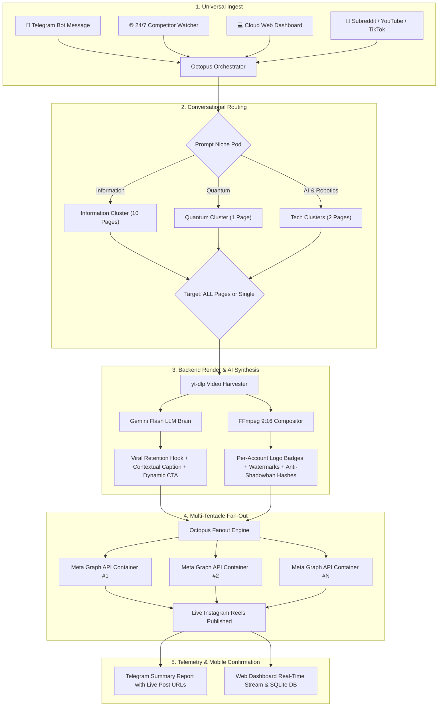

# 🐙 Octopus Agent

### Enterprise Autonomous Multi-Account Reels Engine & 24/7 Mobile Command Center

[](https://python.org)
[](https://fastapi.tiangolo.com)
[](https://developers.facebook.com)
[](https://ai.google.dev)
[](https://core.telegram.org/bots)
[](https://ffmpeg.org)
[](https://opensource.org/licenses/MIT)

---

## 🌟 Executive Summary

**Octopus Agent** is a clean-room, reverse-engineered enterprise automation engine designed to operate mass-scale Instagram theme page networks (modeled after high-growth media matrices like `@uncover.quantum`, `@uncover.ai`, `@uncover.robotics`, and `@uncovernews.co`).

Instead of manually editing clips, copying captions, and juggling logins across separate phones, **Octopus Agent** introduces the **1-Source ➔ All-Pages Multi-Tentacle Architecture**:
- 📱 **Mobile-First Command**: Share any reel link (Instagram, YouTube Shorts, Reddit, TikTok) into your **Telegram Chat**.
- 🎯 **Conversational Routing**: The agent prompts you for the **Niche Pod** and target destination pages.
- ⚡ **1-Click Fan-Out**: In a single tap, Octopus triggers the backend renderer, synthesizes viral hooks & captions via Gemini AI, composites 9:16 vertical video cards with per-account branding, and broadcasts simultaneously across dozens or hundreds of Instagram pages.

---

## 🏗️ System Architecture & Workflow



---

## 🚀 Key Features

### 1. 📱 Telegram Autonomous Remote Command Center (Omni Flow)
- **Zero-Friction Mobile Control**: Send any reel link from your phone directly to the Octopus Telegram Bot.
- **2-Step Conversational State Machine**:
  1. *Link Detected* ➔ Bot prompts: *"Which niche pod do you want to publish on?"* with clickable inline buttons.
  2. *Niche Selected* ➔ Bot prompts: *"On which page(s) do you want to publish?"* with a primary **`🐙 Publish to ALL (10) Pages`** button.
  3. *Executed* ➔ Real-time progress updates sent to Telegram, concluding with direct links to the published Instagram reels.
- **Commands**: `/start`, `/niches`, `/accounts`, `/cycle` (trigger autonomous 24/7 harvest pass).

### 2. 🐙 1-Source ➔ All-Pages Multi-Tentacle Fanout
- **Niche Pods Hub**: Group dozens to hundreds of accounts into dedicated thematic pods:
  - 💡 **Information & Infotainment**: 10 destination pages (`@info.daily`, `@curious.minds`, `@daily.knowledge`, `@deep.facts`, `@mind.uncovered`, etc.)
  - ⚛️ **Quantum Physics & Modern Mechanics**: `@octopus.quantum`
  - 🤖 **Generative AI & Machine Learning**: `@octopus.ai`
  - 🦾 **Humanoid Robotics & Embodied AI**: `@octopus.robotics`
  - 🚀 **Astrophysics & Space Exploration**: `@octopus.space`
  - 🧬 **Synthetic Biology & Longevity**: `@octopus.biotech`
- **Dynamic Per-Account Attribution**:
  - Dynamically interpolates the target account handle into the follow call-to-action:
    `"Follow @{destination_account} for daily breakthroughs!"`
  - Unique logo badges rendered onto each video per target page.
- **Anti-Shadowban & Anti-Duplicate Protection**:
  - Subtle pixel modifications, unique binary frame hashing, and dynamic audio shifts so algorithms perceive each upload as distinct original creative work.

### 3. 🧠 Gemini Flash AI Copywriting Brain
- **Viral Retention Hook**: Synthesizes 10–18 word curiosity-driven on-screen hooks (sentence case, clean typography).
- **3-Paragraph Educational Caption**:
  - Paragraph 1: Intriguing physical observation / news hook.
  - Paragraph 2: Underlying mechanics / scientific explanation.
  - Paragraph 3: Follow CTA and source credits.
- **Niche-Specific Hashtags**: Automatically appends 10–15 curated, non-repetitive tags to avoid algorithmic penalties.

### 4. 🎨 FFmpeg 9:16 Vertical Video Compositor
- **Uncover-Style Layout**:
  - Upper 35%: Minimal dark canvas housing channel badge, handle, and headline.
  - Lower 65%: Centered source video scaled with zero distortion.
- **Aspect Fit Modes**:
  - 🎞️ `1:1 Centered Pillarbox` (Default)
  - 🌫️ `Dynamic Ambient Blur Fill`
  - ✂️ `9:16 Smart Dynamic Crop`
- Hardware-accelerated lossless encoding producing crisp 1080×1920 MP4s.

### 5. 🔄 24/7 Competitor Scraping & Scheduled Daemons
- Automatically monitors viral competitor Instagram profiles, subreddits (r/physicsgifs, r/QuantumComputing), and YouTube channels.
- Built-in deduplication database: records URL hashes to ensure zero duplicate downloads or double-posts.

### 6. 💻 Minimalist Warm Linen & Terracotta Web Dashboard
- Beautiful bespoke UI built with Tailwind CSS, warm linen palette (`#FAF8F5`), and refined terracotta accents (`#C86237`).
- Zero horizontal or vertical scrollbar overflows.
- Integrated **Telegram Bot Simulator**: test the full interactive workflow directly in your desktop browser!

---

## 📂 Repository Structure

```
octopus-agent/
├── assets/                          # Branding assets, mascot illustrations, and pod logos
│   ├── logos/                       # Per-account circular badges (logo_info_01.png, etc.)
│   ├── octopus_logo.png             # Master 2D mascot wearing modern headphones
│   └── logo.png                     # Primary application logo
├── bot/                             # Telegram Mobile Command Center
│   ├── octopus_telegram_bot.py      # Stateful 2-step conversational bot controller
│   └── telegram_reviewer.py         # 1-click video preview and mobile approval bot
├── output/                          # Storage for composited 9:16 MP4s and visual previews
│   └── .gitkeep
├── processors/                      # AI copywriting & LLM intelligence
│   ├── ai_enricher.py               # Gemini Flash prompt orchestration
│   └── llm_manager.py               # Multi-model LLM router (Gemini, Grok, GPT)
├── publisher/                       # Social network publication engines
│   ├── meta_graph_api.py            # Meta Instagram Graph API container publisher
│   └── octopus_fanout.py            # Multi-account simultaneous fanout engine
├── renderers/                       # Video & visual compositing pipelines
│   ├── card_renderer.py             # Pillow-based header and badge compositing
│   └── video_compositor.py          # Hardware-accelerated FFmpeg 9:16 compositor
├── scrapers/                        # Ingestion and competitor monitoring
│   ├── content_harvester.py         # Universal yt-dlp video downloader
│   └── instagram_harvester.py       # Competitor Instagram handle scraper
├── storage/                         # Database models and SQLite persistence
│   ├── db.py                        # SQLite schema, niche pods, accounts, and sources
│   ├── llm_config.json              # Active LLM configuration
│   └── .gitkeep
├── templates/                       # Minimalist Web Dashboard
│   ├── index.html                   # Unified production HTML single-page app
│   ├── part1.html                   # Sidebar navigation and header
│   ├── part2.html                   # Dashboard stage and Telegram Command Center
│   └── part3.html                   # JavaScript state controllers and simulator
├── tests/                           # Unit and integration test suites
│   ├── test_telegram_bot.py         # Automated test for 2-step Telegram workflow
│   ├── test_minimalist_sidebar.py   # Playwright test for zero-scrollbar sidebar
│   └── test_reels_removal.py        # Playwright test for layout verification
├── .env.example                     # Environment template with required credentials
├── .gitignore                       # Standard Python, media, and DB exclusions
├── config.py                        # Centralized settings and channel profiles
├── daemon.py                        # 24/7 background scheduler (APScheduler)
├── pipeline.py                      # End-to-end CLI pipeline runner
├── requirements.txt                 # Project dependencies
└── server.py                        # FastAPI enterprise application server
```

---

## 🛠️ Getting Started

### 1. Prerequisites
- **Python 3.10+**
- **FFmpeg**: Ensure `ffmpeg` and `ffprobe` are installed and available on your system `PATH`.
  - Windows: `winget install Gyan.FFmpeg` or `choco install ffmpeg`
  - macOS: `brew install ffmpeg`
  - Linux: `sudo apt install ffmpeg`

### 2. Clone the Repository
```bash
git clone https://github.com/harshparmar2004/octopus-agent-.git
cd octopus-agent-
```

### 3. Create a Virtual Environment
```bash
python -m venv venv

# On Windows:
venv\Scriptsctivate

# On macOS/Linux:
source venv/bin/activate
```

### 4. Install Dependencies
```bash
pip install -r requirements.txt
```

### 5. Configure Environment Variables
Copy `.env.example` to `.env`:
```bash
cp .env.example .env
```
Open `.env` and fill in your credentials:
```ini
# Meta Instagram Graph API
INSTAGRAM_USER_ID=your_instagram_business_account_id
META_GRAPH_ACCESS_TOKEN=your_long_lived_user_access_token
META_GRAPH_API_VERSION=v21.0

# Google Gemini API (for AI hooks & captions)
GEMINI_API_KEY=your_gemini_api_key

# Video Storage (Public URL required by Meta Graph API)
STORAGE_PROVIDER=local_tunnel
PUBLIC_BASE_URL=http://localhost:8000

# Telegram Mobile Command Center
TELEGRAM_BOT_TOKEN=your_bot_token_from_botfather
TELEGRAM_CHAT_ID=your_personal_or_admin_chat_id

# Default Channel Profile
DEFAULT_CHANNEL=quantum
```

---

## 📱 Telegram Mobile Command Center Setup

1. Open Telegram and search for **`@BotFather`**.
2. Send `/newbot`, name your bot (e.g. `MyOctopusAgentBot`), and receive your `TELEGRAM_BOT_TOKEN`.
3. Start a chat with your new bot by tapping **`/start`**.
4. Retrieve your Telegram Chat ID by messaging **`@userinfobot`**.
5. Paste both values into your `.env` file:
   ```ini
   TELEGRAM_BOT_TOKEN=123456789:ABCdefGhIJKlmNoPQRstuVWXyz
   TELEGRAM_CHAT_ID=987654321
   ```
6. Whenever the server or bot daemon runs, it begins long-polling Telegram automatically.
   - Send any link: `https://www.instagram.com/reel/C8q_viral_physics`
   - Select your Niche Pod via the interactive buttons.
   - Tap **`🐙 Publish to ALL Pages`** to trigger the fanout.

---

## 💻 Running the Application

### Option A: Launch the Unified Web Dashboard (Recommended)
```bash
python -m uvicorn server:app --host 0.0.0.0 --port 8000 --reload
```
Open your browser and navigate to:
**`http://localhost:8000`**

- **Overview**: Cloud analytics, monitored sources, active pages, and recent broadcast stream.
- **Niche Groups**: Manage pod destination accounts, dynamic follow templates, and competitor feeds.
- **Setup ➔ Workflow**: The **Telegram Autonomous Remote Command Center** with live interactive simulator and technical pipeline controls.
- **Accounts**: Multi-account credential manager and connection health monitor.
- **Publish**: Manual single-clip ingest with instant multi-page deployment.

---

### Option B: CLI Pipeline (Dry-Run Test)
Test the scraper, AI enricher, and FFmpeg video compositor without publishing:
```bash
# Test with a specific video link
python pipeline.py quantum "https://www.instagram.com/reel/C8q_viral_physics"

# Or harvest the latest viral clip from the niche's subreddits
python pipeline.py quantum
```

---

### Option C: 24/7 Background Scheduler Daemon
Run the autonomous daemon that continuously monitors competitor handles and subreddits every 4 hours:
```bash
python daemon.py
```

---

## 📡 REST API Reference

| Method | Endpoint | Description |
| :--- | :--- | :--- |
| `GET` | `/api/stats` | Network KPI metrics (connected accounts, sources, reels, success rate) |
| `GET` | `/api/telegram/status` | Current Telegram bot polling status, username, and active sessions |
| `POST` | `/api/telegram/test_ping` | Sends a ping test notification to the configured Telegram chat |
| `POST` | `/api/telegram/dispatch_step` | Advance the conversational flow (`start`, `select_niche`, `execute`) |
| `GET` | `/api/telegram/logs` | Telemetry history of recent Telegram inbound dispatches |
| `GET` | `/api/niches` | List all configured niche pods |
| `GET` | `/api/niches/{id}/cluster` | Retrieve full cluster details (accounts, sources, automation config) |
| `POST` | `/api/niches/{id}/config` | Update dynamic CTA, hook style, and hashtag preferences for a niche |
| `POST` | `/api/ingest` | Universal clip ingest with optional automatic multi-account fan-out |
| `POST` | `/api/broadcast/{reel_id}` | Broadcast an existing rendered reel across specified accounts |
| `GET` | `/api/accounts` | List all destination Instagram accounts in the network |
| `POST` | `/api/accounts` | Add or update an Instagram account in the database |
| `GET` | `/api/sources` | List all monitored competitor handles and subreddits |
| `POST` | `/api/sources` | Add a new competitor handle or subreddit to monitor 24/7 |
| `POST` | `/api/daemon/cycle` | Immediately trigger an autonomous 24/7 scraping & publish cycle |

---

## 🧪 Running Tests

```bash
# Run Telegram Bot state machine unit tests
python tests/test_telegram_bot.py

# Run Playwright UI visual tests (requires: pip install playwright && playwright install)
python tests/test_minimalist_sidebar.py
```

---

## 🛡️ Anti-Shadowban & Scaling Safeguards

When operating 10, 20, or 100+ Instagram theme pages from one central infrastructure, algorithmic flags must be proactively mitigated:
1. **Dynamic Binary Hashes**: FFmpeg applies micro-adjustments to color LUTs, audio pitch (±0.8%), and imperceptible noise filters so every exported MP4 yields a unique cryptographic MD5/SHA256 signature.
2. **Staggered Fan-Out Schedule**: The fan-out engine introduces configurable delays (e.g. 15–45 seconds) between API container dispatches to prevent rate-limit trips.
3. **Dynamic Attribution Tokens**: Captions use the `@{destination_account}` token to guarantee that no two posted reels share identical text.

---

## 🤝 Contributing & License

Contributions, issues, and feature requests are welcome!

1. Fork the Project
2. Create your Feature Branch (`git checkout -b feature/AmazingFeature`)
3. Commit your Changes (`git commit -m 'Add some AmazingFeature'`)
4. Push to the Branch (`git push origin feature/AmazingFeature`)
5. Open a Pull Request

Distributed under the **MIT License**. See `LICENSE` for more information.

---

<p align="center">
  <b>Built with 🐙 by <a href="https://github.com/harshparmar2004">Harsh Parmar</a></b><br>
  <i>Empowering creators & agency operators with autonomous multi-account agentic workflows.</i>
</p>
